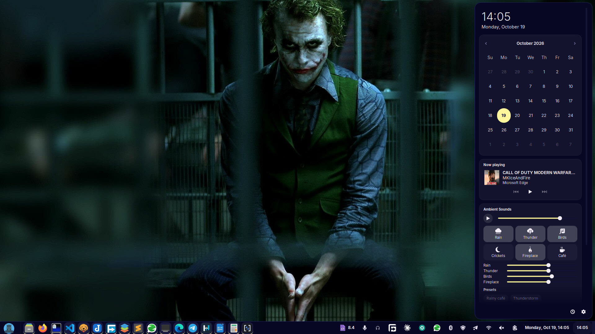
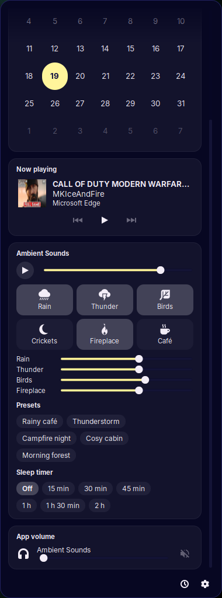

# Side Panel

A clock for the Cinnamon panel that opens a side panel of widgets. Think of
it as a notification centre and dashboard for Linux Mint.



<p align="center">
  
  <br><em>Scrolled down: Ambient Sounds presets and sleep timer, and app volume.</em>
</p>

**Status: phase 2.** Coming next: notifications, then weather and a way to
add, remove and reorder widgets.

## Widgets

| Widget | What it does |
| --- | --- |
| Date and time | The time and today's date, large. |
| Calendar | Month view; arrows or scrolling change month, clicking the month name returns to today. Styled by your theme's calendar rules. |
| Now playing | Every media player (MPRIS): cover art, title, artist, and previous / play-pause / next. Click a player to bring its window forward. |
| App volume | A volume slider and mute button for each app playing sound. |
| Ambient Sounds | Shipped by the [Ambient Sounds](https://github.com/PhillipMwaniki/ambient-sounds) applet when it's installed: sound tiles, levels, presets and a sleep timer. |

## Using it

- Click the clock, or press **Super+N**, to open the panel. Click anywhere
  outside it, press **Escape**, or press the shortcut again to close it.
- The panel opens on the same side of the screen as the clock. You can pin
  it to the left or right, and change its width, in the applet's settings.
- The clock follows your system 12/24-hour setting, or takes a custom
  strftime format.

## Install

```sh
ln -s "$PWD/sidepanel@PhillipMwaniki" ~/.local/share/cinnamon/applets/
```

Then add **Side Panel** from *System Settings → Applets*. You'll probably
want to remove the stock Calendar applet, since this one replaces it.

## Writing widgets

Widgets are self-contained folders with a `widget.json` and a `widget.js`.
Other applets can ship one in a `sidepanel-widget/` folder, so they work on
their own and also appear in the panel when it's installed.

See [docs/WIDGETS.md](docs/WIDGETS.md) for the contract.

## Development

Reload after editing:

```sh
gdbus call --session --dest org.Cinnamon --object-path /org/Cinnamon \
  --method org.Cinnamon.Eval \
  "imports.ui.extension.reloadExtension('sidepanel@PhillipMwaniki', imports.ui.extension.Type.APPLET)"
```

Modules are loaded with `require()`, which picks up changes on reload.

## Licence

[MIT](LICENSE)
